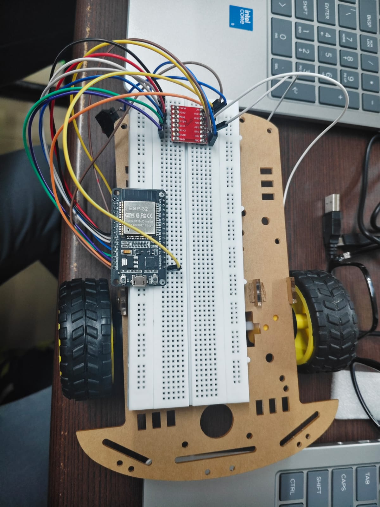

# Gesture Controlled Bot

A two-wheel robot that you drive with your hand. A webcam counts how many fingers you show, and the robot moves accordingly.

| Fingers shown | Robot action |
|---|---|
| 0 (fist) | Stop |
| 1 | Forward |
| 2 | Backward |
| 3 | Turn left |
| 4 | Turn right |
| anything else | Stop |



## How it works

```
Webcam -> OpenCV + MediaPipe (count fingers) -> UDP over Wi-Fi -> ESP32 (MicroPython) -> TB6612FNG driver -> 2 DC motors
```

1. `gestured_file.py` runs on the laptop. It reads the webcam, finds the hand with MediaPipe landmarks, counts the extended fingers and sends the number to the ESP32 as a UDP packet (port 4210).
2. `esp32.py` runs on the ESP32. It joins Wi-Fi, listens for the UDP packets and drives the motors through the TB6612FNG.
3. **Safety stop:** if no packet arrives for 0.1 s (hand out of view, Wi-Fi drop), the robot stops.
4. `ip.py` is a small helper that connects the ESP32 to Wi-Fi and prints its IP address.

## Hardware

- ESP32 development board (flashed with MicroPython)
- TB6612FNG dual motor driver
- 2 DC gear motors with wheels on a 2-wheel chassis
- Battery pack with a switch (powers the motors through the driver's VM pin)
- Breadboard and jumper wires
- Laptop with a webcam

### Wiring (TB6612FNG to ESP32)

| TB6612FNG | ESP32 |
|---|---|
| PWMA | GPIO 33 |
| AIN1 | GPIO 26 |
| AIN2 | GPIO 25 |
| PWMB | GPIO 13 |
| BIN1 | GPIO 14 |
| BIN2 | GPIO 12 |
| STBY | GPIO 27 |
| VCC | 3V3 |
| GND | GND |
| VM | Battery + (and ESP32 VIN) |

Motor A connects to A01/A02 and Motor B to B01/B02. Battery negative goes to GND.

## Setup

**ESP32**
1. Flash MicroPython onto the ESP32.
2. In `ip.py` and `esp32.py`, set `WIFI_SSID` and `WIFI_PASSWORD` to your own Wi-Fi.
3. Run `ip.py` once and note the IP address it prints.
4. Save `esp32.py` on the ESP32 as `main.py` so it starts on power-up.

**Laptop** (on the same Wi-Fi network)
```
pip install -r requirements.txt
```
Set `ESP32_IP` in `gestured_file.py` to the address from step 3, then run:
```
python gestured_file.py
```
Show your hand to the camera. Press `q` to quit.

## Known limitations

- Finger counting uses simple landmark comparisons, so it works best with the palm facing the camera in good light.
- No obstacle detection; control is open-loop.
- Laptop and ESP32 must be on the same Wi-Fi network.

## Credits

Motor driver wiring and pin mapping follow the TB6612FNG guide from the roboVITics x Robolark workshop.

Built by Garapati Sai Aditya (solo project).
